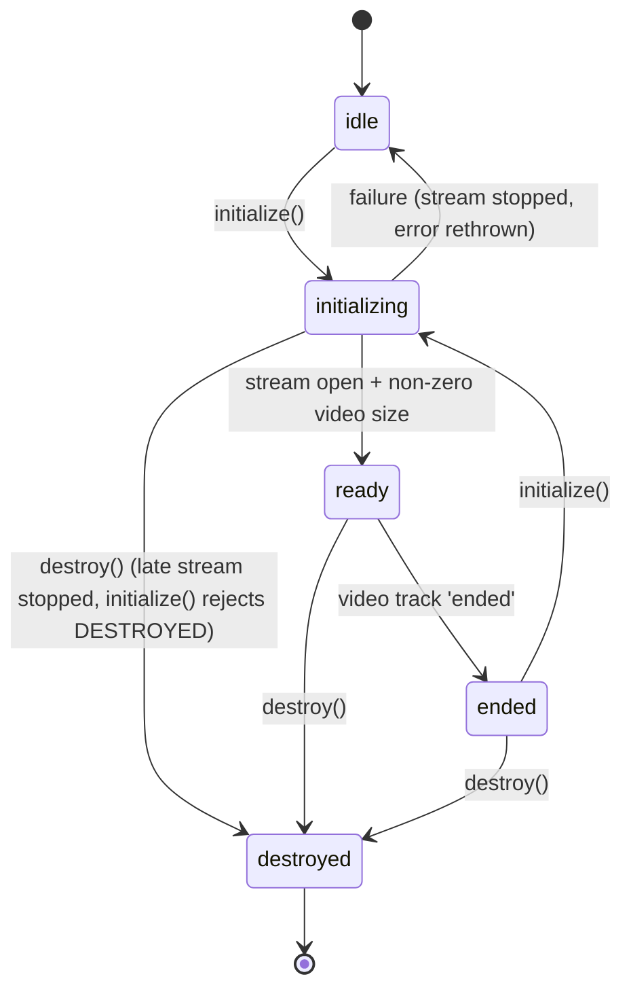

# 0001 — `@webarkit/camera-view`: design

- **Status:** Accepted (brainstorming session, 2026-10-26)
- **Tracking issue:** [webarkit/ARnft#370](https://github.com/webarkit/ARnft/issues/370)
- **Related:** [webarkit/jsartoolkitNFT#720](https://github.com/webarkit/jsartoolkitNFT/issues/720) (data-oriented tracker facade, decision D17: camera handling stays out of the tracker)

## 1. Understanding summary

- **What:** a small, standalone, tracker-agnostic TypeScript package, `@webarkit/camera-view`, whose `CameraView` class
  - opens the camera (`getUserMedia`, device selection by `cameraLabel`, rear camera on phones, fallbacks);
  - fits the video into the processing frame (320 px wide 4:3 letterbox, opt-in `rotatePortrait`, recomputed on video resize);
  - produces frames (`ImageData` throttled to `targetFrameRate`, plus `ImageBitmap`);
  - exposes `geometry: FrameGeometry`, a plain, structured-cloneable value, and a `geometrychange` event.
- **Why:** the same code lives in four copies with diverging fixes (ARnft `src/`, ARnft `examples/`, aframe-nft, webarkit-studio). A shared `FrameGeometry` also lets the jsartoolkitNFT facade compute `projectionFor(viewport, geometry)`, removing every hand-written projection rescale in the consumers.
- **For whom:** ARnft, aframe-nft, webarkit-studio, and later `@webarkit/nft-tracker` and other WebARKit trackers.
- **Fidelity:** the geometry math and the frame pixels are preserved bit for bit (enforced by an oracle test against a frozen copy of ARnft's code); lifecycle and safety bugs are fixed and listed in the README's "Differences from ARnft".
- **Non-goals (0.1.0):** a display/CSS helper, changes inside ARnft, publishing to npm, an `OffscreenCanvas`/worker capture path.

## 2. Assumptions

1. **Performance:** throttling uses an injectable clock (default `performance.now()`); the `ImageData` buffer is reused and one copy is made per `getImage()` call, as in ARnft; geometry is recomputed only on video `resize`.
2. **Browsers:** current evergreen browsers (Chrome/Edge, Firefox, Safari 15+). Build target ES2020. `createImageBitmap` is required only by `getImageBitmap()`.
3. **Privacy/security:** no audio is ever requested; device ids are never logged; every track opened is stopped on `destroy()` or on a failed/abandoned `initialize()`.
4. **Scale/reliability:** one instance per `<video>` element; `initialize()` may be called again only from `idle` or `ended`.
5. **Geometry:** `FrameGeometry` carries the **floored** values (what is actually drawn on the process canvas). ARnft's worker uses the unfloored values (`getWindowSize`); the test suite documents the difference so it can be reported back to ARnft.
6. **Events:** `CameraView extends EventTarget`; events are per instance, nothing is dispatched on `window`. The ARnft `videoResize` compatibility event belongs in ARnft.
7. **Ownership/tooling:** maintained by the WebARKit maintainers; Node pinned in `.nvmrc` (v24.21.0); npm as package manager.

## 3. Decision log

| # | Decision | Alternatives considered | Why |
|---|----------|-------------------------|-----|
| D1 | Separate repository `webarkit/camera-view`, package `@webarkit/camera-view` | package in the `webarkit` monorepo; keep it in ARnft | Option 1 of the issue: independent releases, small dependency, clear owner. |
| D2 | Preserve geometry and pixels bit for bit; fix lifecycle/safety bugs and document them | strict bit-for-bit copy incl. quirks; clean redesign | Consumers keep identical tracking output while the new API is safe to use. |
| D3 | Layered modules behind one class (`geometry`, `devices`, `frame-source`, `CameraView`) with optional dependency injection | one-class port; functional API | Makes every combination testable with plain fakes; matches the issue's API sketch. |
| D4 | Capture-only for 0.1.0 | add a display helper; export utilities | YAGNI; the display helper is an open question of the issue and can come later. |
| D5 | Class `CameraView`, LGPL-3.0-or-later, branches `dev` (integration) + `main` (releases) | other class names; `master` | Matches the issue's sketch and the WebARKit licensing and workflow. |
| D6 | Vite library mode: ESM + UMD, `.d.ts` from `tsc`, zero runtime dependencies, TypeScript strict | ESM only; plain `tsc` | Script-tag consumers (aframe-nft, examples) need UMD. |
| D7 | Two Vitest projects: `unit` (happy-dom + fakes) and `browser` (Vitest Browser Mode + Playwright Chromium) | unit only; browser only | Logic permutations are cheap with fakes; rotation/letterbox pixels need a real canvas. |
| D8 | Five lifecycle states: `idle`, `initializing`, `ready`, `ended`, `destroyed`; an `ended` event | four states, silent frozen frames | A camera that is unplugged or revoked must not keep returning a stale frame silently. |
| D9 | Failure in `initialize()` returns to `idle` (retry allowed); no `error` state | dedicated `error` state | The error is already thrown to the caller; an extra state adds nothing. |
| D10 | Browser `getUserMedia` errors are re-thrown unchanged; package errors are `CameraViewError` with a `code` | wrap everything | Consumers already handle `NotAllowedError` etc. by `name`. |
| D11 | Keep ARnft-compatible accessors (`image`, `frame`, `getFrame()`, `width`, `height`, `facing`, `rotated`, `video`, `canvasProcess`) | new API only | ARnft can wrap `CameraView` with minimal changes and keep `ICameraViewRenderer`. |
| D12 | `fast-check` property tests + an oracle copy of ARnft's `getProcessGeometry` | hand-written tables only | "Test all the possible combinations" over a continuous input space. |
| D13 | `package.json` complete for npm publication (exports, files, provenance-ready `publishConfig`), but nothing is published yet | minimal manifest | Requested by the maintainer; publishing is a separate, explicit step. |

## 4. Final design

### 4.1 Module layout

```
src/
  index.ts          public exports only
  CameraView.ts     class, lifecycle, events
  geometry.ts       getProcessGeometry, toFrameGeometry (pure)
  devices.ts        camera selection over an injected MediaDevices (pure logic)
  frame-source.ts   process canvas, drawFrame, throttled ImageData / ImageBitmap
  errors.ts         CameraViewError and its codes
  types.ts          options, geometry and dependency types
```

### 4.2 Public API

```ts
export class CameraView extends EventTarget {
    constructor(video: HTMLVideoElement, deps?: Partial<CameraViewDeps>);
    initialize(options?: CameraViewOptions): Promise<void>;
    readonly state: "idle" | "initializing" | "ready" | "ended" | "destroyed";
    readonly geometry: FrameGeometry; // throws NOT_INITIALIZED before ready
    getImage(): ImageData; // frameWidth x frameHeight, throttled, fresh copy
    getImageBitmap(): Promise<ImageBitmap>;
    destroy(): void; // idempotent
    // ARnft-compatible accessors
    readonly image: ImageData;
    readonly frame: number;
    getFrame(): number;
    readonly width: number; // video width
    readonly height: number; // video height
    readonly facing: string;
    readonly rotated: boolean;
    readonly video: HTMLVideoElement;
    readonly canvasProcess: HTMLCanvasElement;
}
export function getProcessGeometry(vw, vh, rotatePortrait?, floor?): ProcessGeometry;
export function toFrameGeometry(vw, vh, geometry: ProcessGeometry): FrameGeometry;
export class CameraViewError extends Error { readonly code: CameraViewErrorCode }
```

`CameraViewOptions` is a superset of ARnft's `VideoSettingData`, every field optional: `facingMode` (default `"environment"`), `cameraLabel`, `width: { min, max }`, `height: { min, max }` (accepted for config compatibility, **not** sent to `getUserMedia`, as in ARnft), `targetFrameRate` (default 60), `rotatePortrait` (default `false`).

`CameraViewDeps` (testing and advanced use): `mediaDevices`, `now()`, `createCanvas()`, `isMobile()`, `createImageBitmap`.

Events: `geometrychange` (`CustomEvent<FrameGeometry>`) when a video `resize` changes the video size; `ended` (`Event`) when the video track ends.

```ts
interface FrameGeometry {
    frameWidth: number; frameHeight: number;             // pw x ph
    videoWidth: number; videoHeight: number;             // vw x vh
    x: number; y: number; width: number; height: number; // ox, oy, w, h
    rotated: boolean;                                    // rot
}
```

### 4.3 Lifecycle



`initialize()`:

1. Guard the state; bump an internal `generation` counter.
2. `NOT_SUPPORTED` without `mediaDevices.getUserMedia`; `INVALID_OPTIONS` for bad options.
3. Camera selection (unchanged ARnft logic): hint `{ audio: false, video: { facingMode, width: { min, max } } }`; label set but labels hidden → open the default camera, re-enumerate, reopen on the matching camera if it is a different one (falling back to the default); label matching → open it `deviceId: { exact }` with fallback; otherwise on mobile with more than one camera → the last camera; otherwise the default hint.
4. `video.srcObject = stream`; wait for `loadedmetadata` (and for a non-zero size).
5. If `generation` changed meanwhile, stop the stream and reject `DESTROYED`.
6. `prepare()`: `getProcessGeometry(vw, vh, rotatePortrait, true)`, size and clear the process canvas, freeze the `FrameGeometry`.
7. Attach `resize` (video) and `ended` (track) listeners; `ready`.

`getImage()`: requires `ready`; draws and copies a new frame when `now() - lastCache > 1000 / targetFrameRate` (the first call always draws), increments `frame`, and returns `new ImageData(cache.slice(), pw, ph)`.

`destroy()`: bump `generation`, remove listeners, stop every track, `video.srcObject = null`, `destroyed`.

### 4.4 Errors and edge cases

| code | when |
|---|---|
| `NOT_SUPPORTED` | no `navigator.mediaDevices.getUserMedia` |
| `NOT_INITIALIZED` | frame or geometry access in `idle` / `initializing` |
| `ALREADY_INITIALIZED` | `initialize()` in `initializing` / `ready` |
| `STREAM_ENDED` | frame access in `ended` |
| `DESTROYED` | any call after `destroy()`, or `destroy()` during `initialize()` |
| `INVALID_OPTIONS` | `targetFrameRate` ≤ 0 or NaN, `width.min > width.max`, non-string `cameraLabel` |

Handled edge cases: zero video size at `loadedmetadata`; extreme and odd sizes; `targetFrameRate: Infinity`; missing `enumerateDevices`; hidden labels with no match; busy matching camera; first stream already on the matching device (no reopen); `destroy()` during the reopen; `resize` after `destroy()`; non-monotonic clock.

### 4.5 Testing strategy

See [`docs/testing.md`](../testing.md).

### 4.6 Risks

- **Vitest Browser Mode in CI** needs the Playwright Chromium download; mitigated by caching and by keeping the browser project small.
- **happy-dom fidelity:** canvas/video are faked in the unit project; the pixel truth lives only in the browser project.
- **Floor vs unfloored geometry:** consumers that mix `FrameGeometry` with ARnft's `getWindowSize` can see a sub-pixel projection mismatch; documented, to be resolved in ARnft's migration.
